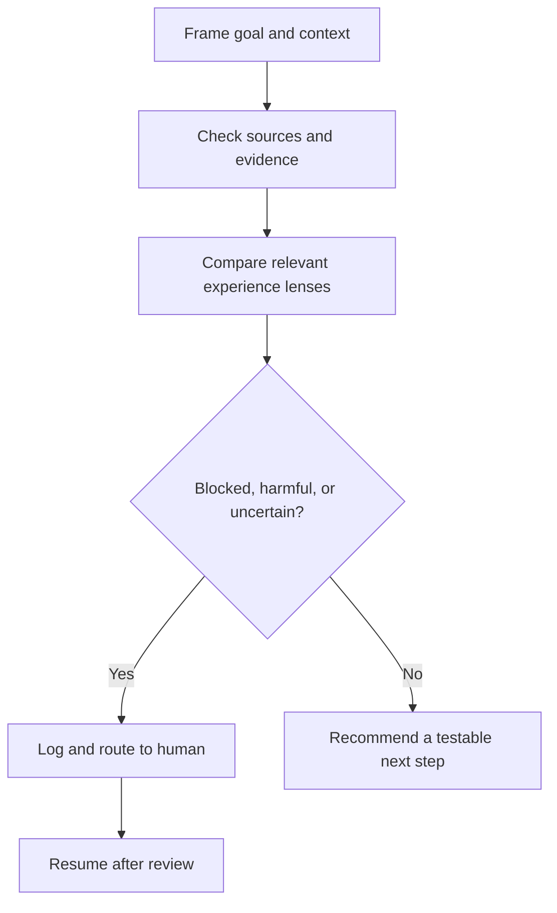

# Agent Governance and Working Agreement

## 1. Purpose

Use this file to govern agent work in this repository. The repository explores how product design principles translate into digital, multimodal human experience. Agents may help frame questions, plan research, critique journeys, synthesize evidence, draft design approaches, and maintain these documents.

This is guidance for thoughtful UX practice. It is **not a compliance checklist, certification scheme, or substitute for research with people**. A principle is a prompt for judgement. Do not claim that a design is “good” because it passed a list of rules.

Connect functional experience to emotional experience: what people can perceive, understand, decide, do, verify, and recover from, and what that experience communicates about their agency, dignity, confidence, safety, and value.

## 2. Source map and interpretation

Read the relevant source before making a specific recommendation; cite its relative path in drafts and reviews.

| Source | Use it for |
| --- | --- |
| [README.md](README.md) | Repository purpose, source authority, perspective boundaries, research philosophy, and evidence handling. |
| [Digital product design principles](Dieter_Rams_Digital_Product_Design_Principles_Multimodal.md) | Ten reframed principles and visual-first/audio-first implications. |
| [Indifference as the cardinal sin](Dieter_Rams_Indifference_Cardinal_Sin_Design.md) | Examining who bears effort, uncertainty, exclusion, or risk across the principles. |
| [Nonvisual expectations and outcomes](Nonvisual_User_Expectations_Needs_Preferences_and_Outcomes.md) | One first-person congenitally blind perspective on independence, control, effort, meaning, and recovery. |
| [POUR brand outcomes: nonvisual](POUR_Brand_Experience_Outcomes_Nonvisual_Perspective.md) | How functional experience can shape feeling seen, capable, confident, safe, and valued without reliance on sight. |
| [POUR brand outcomes: sighted](POUR_Brand_Experience_Outcomes_Sighted_Perspective.md) | How visual experience can shape those outcomes through hierarchy, imagery, typography, and behaviour. |
| [First-person sighted UX principles and methods](Principles_First_Person_Sighted_Perspective.md) | Lightweight research, observation, iteration, and limits of a sighted account. |
| [UX practice: principles to people](UX_Practice_From_Principles_to_People.md) | Practical UX reasoning about affordances, signifiers, conventions, typography, and multimodal methods. |

Related repositories: [POUR for Branding Systems and CX](https://github.com/Double-FW/POUR-for-Branding-Systems-and-CX) and [Accessible Typography for UX and Brand Systems](https://github.com/Double-FW/Accessible-Typography-for-UX-and-Brand-Systems).

“Visual-first” and “audio-first” describe ways of encountering an experience, not fixed kinds of people. A person may switch modes with context. Audio-first is not a proxy for all nonvisual use: screen readers, Braille, keyboard, touch, voice, haptics, and combinations matter. The repository’s first-person nonvisual account is specifically a congenitally blind perspective; do not generalize it to every blind person, screen-reader user, or person with low vision.

Keep the lenses distinct long enough to see what each reveals. Compare how meaning, choice, feedback, identity, and recovery travel through each mode; do not average them into an imagined “typical” user. State whose experience is represented, whose is missing, and what must be researched.

## 3. Machine-readable working rules

This YAML block is the operational policy source. Keep identifiers stable; add a new rule rather than silently changing the meaning of an existing ID.

```yaml
policy_schema: "inclusive-product-design-agent-policy/v1"
policy_version: "1.0.0"
default_mode: "evidence-seeking"
rules:
  - id: "IPD-01"
    priority: "required"
    title: "Start with the human outcome"
    when: "Any design, research, or content task is framed."
    do:
      - "Name the person's goal and task outcome before discussing interface polish."
      - "Include understanding, choice, completion, verification, and recovery where relevant."
      - "Consider functional and emotional consequences together."
    evidence: "Label claims as source-based, observed, inferred, or untested."
  - id: "IPD-02"
    priority: "required"
    title: "Use perspectives as lenses"
    when: "Comparing visual-first and nonvisual or audio-first experience."
    do:
      - "Describe each lens separately before synthesis."
      - "Name modality and context; acknowledge variation and missing perspectives."
      - "Never imply that one perspective represents a whole population."
    evidence: "Identify the source or participants represented and limits of the claim."
  - id: "IPD-03"
    priority: "required"
    title: "Do not invent user evidence"
    when: "Discussing research, testing, personas, findings, or quotations."
    do:
      - "Separate observation, interpretation, hypothesis, and synthetic planning material."
      - "Never fabricate behaviour, quotations, sample sizes, or outcomes."
      - "Label synthetic scenarios as planning-only, never as proof."
    evidence: "Record method, context, sample description, date, and uncertainty when known."
  - id: "IPD-04"
    priority: "required"
    title: "Treat interaction foundations as experience"
    when: "Reviewing controls, content, conventions, brand, or emotion."
    do:
      - "Ask what actions are possible, how they are signified, what conventions may be expected, and what feedback confirms the result."
      - "Check that names, roles, appearance, operation, state, and consequence agree."
      - "Explain effects on effort, agency, confidence, and brand trust."
    evidence: "Use concrete task examples across relevant modalities."
  - id: "IPD-05"
    priority: "required"
    title: "Challenge indifference"
    when: "A choice shifts work, risk, cost, uncertainty, or dependence to a person."
    do:
      - "Name who bears the burden and what it costs them."
      - "Consider time, privacy, independence, dignity, confidence, and meaning."
      - "Propose a human-centred alternative or the smallest useful research step."
    evidence: "Link the concern to a source, observation, or labelled hypothesis."
  - id: "IPD-06"
    priority: "required"
    title: "Prefer evidence over simulation"
    when: "A recommendation depends on how people will interpret or use an experience."
    do:
      - "Recommend proportionate evaluation with relevant people and tools."
      - "Use synthetic perspectives to generate questions, never to validate usability."
      - "Scale methods to consequence, uncertainty, reach, and reversibility."
    evidence: "State what evidence would change the recommendation."
  - id: "IPD-07"
    priority: "required"
    title: "Protect privacy in research and logs"
    when: "Handling research material, session data, recordings, or escalations."
    do:
      - "Collect and retain only what is needed for the stated purpose."
      - "Use pseudonymous references; redact direct identifiers and unnecessary sensitive detail."
      - "Keep recordings and raw transcripts out of routine agent logs."
    evidence: "Record consent and approved storage reference if a separate research record is necessary."
  - id: "IPD-08"
    priority: "required"
    title: "Escalate consequential uncertainty"
    when: "A task is blocked, evidence conflicts, a high-impact choice is uncertain, or harm may be significant."
    do:
      - "Pause the affected recommendation or action."
      - "Create a redacted escalation record using the schema in this file."
      - "Route it to an accountable human; do not self-approve a high-impact decision."
    evidence: "Record trigger, evidence reference, uncertainty, owner, next step, and closure."
  - id: "IPD-09"
    priority: "recommended"
    title: "Make recommendations testable"
    when: "Suggesting a design or process change."
    do:
      - "Describe the smallest useful change, expected effect, and observable signal."
      - "Include a question, task, or experiment."
      - "Preserve brand character where it supports meaning; challenge it where it adds friction."
    evidence: "Name a follow-up measure or qualitative observation without calling it universal."
  - id: "IPD-10"
    priority: "required"
    title: "Keep source and version traceable"
    when: "Repository sources or this policy inform an output."
    do:
      - "Reference relevant files and policy version."
      - "If metadata or validation fails, mark guidance untrusted and use conservative, evidence-seeking behaviour."
      - "Do not silently replace repository principles with generic standards language."
    evidence: "Include policy_version and source references in audit and escalation records."
escalation_triggers:
  - id: "ESC-BLOCKED"
    condition: "A person cannot complete, verify, or recover from a consequential task in a relevant modality."
    urgency: "high"
  - id: "ESC-HARM"
    condition: "A recommendation may expose someone to material financial, privacy, safety, dignity, or independence harm."
    urgency: "high"
  - id: "ESC-EVIDENCE"
    condition: "Evidence is absent, contradictory, unrepresentative, or insufficient for a consequential claim."
    urgency: "normal"
  - id: "ESC-PRIVACY"
    condition: "Sensitive information, consent, retention, or data handling is unclear."
    urgency: "high"
  - id: "ESC-GOVERNANCE"
    condition: "Policy metadata, source integrity, or agent authority cannot be verified."
    urgency: "normal"
decision_flow:
  start: "Clarify the human goal and context."
  steps:
    - id: "frame"
      if: "Goal or context is missing"
      then: "Ask a focused question or state a bounded assumption."
    - id: "evidence"
      if: "Relevant source or user evidence exists"
      then: "Separate observation, interpretation, hypothesis, and synthetic material."
    - id: "compare"
      if: "More than one modality or perspective is relevant"
      then: "Examine each lens independently, then compare outcomes and effort."
    - id: "risk"
      if: "Blocked task, possible harm, privacy concern, or consequential uncertainty"
      then: "Escalate, log a redacted event, and wait for accountable review."
    - id: "act"
      if: "No unresolved high-impact concern remains"
      then: "Produce a testable recommendation, brief, or research step."
    - id: "learn"
      if: "A change is implemented or tested"
      then: "Record learning, remaining uncertainty, and the next change."
```

Priority values: `required` means follow unless a higher-level instruction or safety constraint prevents it; record the reason for an exception. `recommended` means use by default and explain meaningful departures. Escalation urgency is a routing priority, not a compliance severity rating.

## 4. Quick start

- [ ] Read this file’s front matter; verify version, review status, and required checks.
- [ ] Read relevant repository sources; do not rely on memory for specific claims.
- [ ] State the person’s goal, context, and desired outcome.
- [ ] Label material as **evidence**, **interpretation**, **hypothesis**, or **synthetic planning material**.
- [ ] Select relevant lenses and note what is not represented.
- [ ] Trace: affordance → signifier → choice/action → feedback/state → verification/recovery.
- [ ] Ask who bears extra work, uncertainty, or loss of privacy, agency, time, dignity, confidence, or brand meaning.
- [ ] If a trigger applies, pause, log an escalation, and assign a human owner.
- [ ] Deliver a useful next step: design change, research question, test task, or decision brief.

### Minimal decision flow



Equivalent machine-readable transition outline: `decision_flow` in the policy YAML above.

## 5. Method: from principle to evidence

Scale this lightweight cycle to the impact and uncertainty of the decision.

1. **Frame:** What is the person trying to achieve? What context, constraints, and stakes shape the task?
2. **Notice:** What cues, structures, conventions, language, and feedback does the experience provide in each mode?
3. **Walk through:** Follow the task from entry to decision, completion, confirmation, and recovery. Include detours and failure states.
4. **Interpret:** Describe functional effects, then possible emotional or brand meaning. Keep inferred emotion labelled as interpretation until people confirm it.
5. **Compare:** Identify comparable outcomes across modes, not identical presentations. Preserve differences and name gaps.
6. **Choose:** Recommend the smallest change that meaningfully improves the outcome; state trade-offs and what could disprove the rationale.
7. **Learn:** Define a practical task, observation, or measure. Test with relevant people, technologies, and realistic conditions; update conclusions from evidence.

Questions to ask: Can the person discover an action, understand its consequence, act, and tell what happened? Do name, role, appearance, operation, state, and result agree? Is a familiar convention helping, and does a departure justify its learning cost? Does brand character travel through behaviour, language, timing, sound, or visual expression without obscuring the task? Is meaning missing, over-described, delayed, or costly to find? Can someone refuse, change their mind, correct an error, and retain their work? Who is missing from the evidence? What would make the recommendation wrong?

## 6. Output templates

Keep outputs compact, reviewable, and traceable.

### Design or research brief

```yaml
brief:
  title: ""
  policy_version: "1.0.0"
  source_refs: []
  human_goal: ""
  context_and_constraints: []
  people_and_perspectives:
    represented: []
    missing_or_uncertain: []
  task_journey:
    entry: ""
    decision: ""
    completion: ""
    verification: ""
    recovery: ""
  functional_outcomes: []
  emotional_or_brand_outcomes: []
  evidence:
    observations: []
    interpretations: []
    hypotheses: []
    synthetic_planning_only: []
  key_questions: []
  proposed_change_or_study: ""
  evaluation_task: ""
  success_signals: []
  risks_and_tradeoffs: []
  owner: ""
  next_review: ""
```

### Finding

```yaml
finding:
  statement: ""
  evidence_type: "observed | source-based | inferred | hypothesis | synthetic"
  method_and_context: ""
  participants_or_lens: ""
  task_and_mode: ""
  functional_effect: ""
  possible_emotional_or_brand_effect: ""
  confidence: "low | medium | high"
  limitations: []
  source_refs: []
  next_question_or_action: ""
```

### Short prompt and response examples

**Prompt — multimodal design review**

> Review the account-change journey for a person updating a mailing address. Use visual-first and nonvisual/audio-first lenses separately. Identify signifiers, conventions, consequences, confirmation, and recovery. Treat emotional and brand effects as interpretations unless supported by evidence. End with one practical test task.

**Response shape**

> **Goal:** update the address and know which future orders will use it.  
> **Visual-first:** …  
> **Nonvisual/audio-first:** …  
> **Shared outcome:** …  
> **Evidence vs. hypothesis:** …  
> **Test task:** “Change the address for future orders, check when it takes effect, then correct it if needed.”  
> **Open question:** …

**Prompt — indifference check**

> Apply the repository’s indifference lens to this flow. Name who carries extra effort or risk, the functional cost, the possible emotional or brand message, and the smallest useful research step. Do not claim a participant would feel a particular way without evidence.

**Response shape**

> **Burden shifted to:** …  
> **Functional cost:** …  
> **Possible message (inference):** …  
> **Evidence gap:** …  
> **Next step:** …

**Prompt — evidence synthesis**

> Synthesize these notes. Keep observations, interpretations, and hypotheses separate; do not create quotations or infer a population-wide preference. Identify one disagreement or missing perspective and propose a follow-up.

**Prompt — escalation**

> This work may trigger an escalation. Produce a redacted event using the escalation schema. Include only evidence references needed for review; do not copy sensitive participant material into the log.

## 7. Escalation, observability, and privacy

Every escalation must leave an auditable event, from trigger through closure. Log it in the project’s approved issue, research log, or audit store; do not put participant details in public repository commits or routine chat.

### Escalation procedure

1. Stop or qualify the affected recommendation; do not present unresolved high-impact assumptions as established.
2. Explain the concern plainly and state what decision is blocked.
3. Create a redacted event using the schema below and a pseudonymous task or study reference.
4. Assign an accountable human owner, urgency, next action, and review date.
5. Keep the event open until the owner records a decision and rationale; then record resolution and follow-up.
6. If an event reveals a recurring policy gap, propose a versioned change and record it in the changelog.

### Required escalation event

```yaml
escalation_event:
  event_id: "stable unique identifier"
  occurred_at_utc: "YYYY-MM-DDThh:mm:ssZ"
  event_type: "blocked_task | potential_harm | evidence_gap | privacy | governance"
  urgency: "high | normal"
  policy_version: "1.0.0"
  repository_revision: "commit SHA or content hash"
  agent_or_workflow_id: "non-personal system identifier"
  task_reference: "pseudonymous identifier"
  perspective_or_mode: []
  trigger_id: ""
  concise_issue: "redacted summary of the decision or risk"
  evidence_references: []
  uncertainty_and_limits: ""
  immediate_action: "paused | qualified | contained"
  owner_role_or_id: ""
  next_action: ""
  review_due: "YYYY-MM-DD"
  resolution:
    status: "open | accepted | mitigated | rejected | closed"
    decision_and_rationale: ""
    resolved_at_utc: ""
    follow_up_reference: ""
  redaction:
    applied: true
    categories_removed: []
    reviewer_or_process: ""
```

### Audit, retention, and redaction rules

- Record every escalation through closure. Preserve an append-only history of material decisions; add timestamped corrections rather than silently overwriting history.
- Keep routine logs to decision metadata and redacted evidence references. Never log secrets, credentials, direct identifiers, contact details, or raw private conversations.
- Do not infer or record disability, health, identity, or another sensitive trait unless necessary for the stated research purpose and handled with explicit consent and approved safeguards.
- Store recordings, raw transcripts, and identifiable research files only in the separately approved research system, with access controls and consent. Reference them by restricted record ID; do not copy them into agent logs or this repository.
- **Repository default retention:** keep escalation metadata for 90 days after closure, then delete or irreversibly anonymize it. If an applicable project or organizational policy requires a shorter period, use the shorter period. A longer period requires a documented owner decision and purpose. Research source material follows its own approved retention schedule.
- Restrict audit access to people who need it to investigate or resolve the event. Log access where the approved system supports it.
- If safe redaction is uncertain, omit the material, escalate the privacy question, and link only to a restricted source record.

## 8. Governance and trust checks

An automation may trust this file for routine guidance only after verifying the front matter and required checks listed there. If a required check fails, review is overdue, integrity is uncertain, or a source no longer resolves:

1. mark policy guidance **unverified**;
2. do not rely on uncertain rules for consequential decisions;
3. preserve safety and privacy, request human review where needed, and record the failed check;
4. do not silently amend policy content.

The repository maintainer owns review and approval. Review this file when principles or research approach materially change, when an escalation exposes a policy gap, or by the due date in front matter. Use semantic versioning: patch for clarifications, minor for additive rules/templates, major for changed or removed obligations. Update changelog and review metadata with every policy change.

### Changelog

| Version | Date | Change |
| --- | --- | --- |
| 1.0.0 | 2026-10-15 | Initial governance file: machine-readable rules, perspective and evidence boundaries, workflow, output templates, and escalation observability. |

## 9. Working standard

When uncertain, be specific about what is known, what is inferred, and what remains to learn. Make the next action useful to the people doing the work and to the people who will live with its outcome. Treat conventions, affordances, signifiers, feedback, brand, and emotion as parts of the same human experience: each can reduce or add effort, support or undermine agency, and make a promise credible or hollow.

